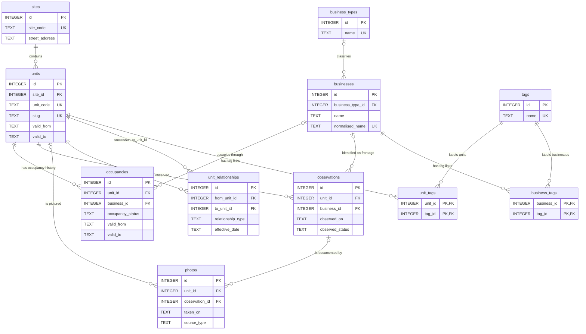

# The Clapham Shopfronts database

The database records how Clapham’s shopfronts change over time: the physical premises, the businesses using them, and the observations and photographs that provide evidence of those changes.

The files are:

| File | Purpose |
| --- | --- |
| [`db/claphamshopfront.db`](db/claphamshopfront.db) | The SQLite database. Note the singular `shopfront` in its filename. |
| [`db/claphamshopfronts.ddl`](db/claphamshopfronts.ddl) | SQL defining the tables, indexes, views, and triggers. |
| [`db.png`](db.png) | The original version-0 diagram. The Mermaid diagram below includes the newer observation-to-business link and unit slug. |

On inspection on 27 October 2026, the database schema matched the DDL: **11 tables, 4 views, 4 triggers, and 19 explicitly defined indexes**, plus SQLite’s automatic indexes for unique constraints and composite primary keys. All tables were empty. SQLite’s integrity check returned `ok`, and its foreign-key check found no violations. That was the initial state; the populated records and updated schema are described below.

The archive began with two photographs of 7 Clapham High Street: [Pure Vintage, vacant on 3 April 2026](data/photos/PXL_20260403_065904338.json), and [Tony Voyage Hair Salon, occupied on 29 October 2026](data/photos/PXL_20261029_130247804.json). [Dentons Catering Equipment at 2-4 Clapham High Street](data/photos/PXL_20260403_065840506.json) adds a separate site and unit, occupied when photographed on 3 April, with a sourced final trading day of 1 May 2026. The growing set of reviewed [import manifests](data/photos/) preserves the evidence and uncertainties. Schema version 1 added an optional `business_id` to observations and one index, bringing the explicit index count to 20. Schema version 2 adds a required, unique `units.slug` for stable public URLs.

## The central idea: location, unit, and occupant

These are three separate things:

| Concept | Meaning | Example |
| --- | --- | --- |
| **Site** | An enduring physical location on the street. | A location recorded as “52 Clapham High Street”. |
| **Unit** | A physical retail configuration at that site, with a period of validity. | One shop frontage, later divided into two smaller units. |
| **Occupancy** | The state of a unit during a particular period, optionally associated with a business. | A café occupies the unit; later it is vacant; then another business moves in. |

A change of business normally creates a new occupancy for the same unit. A material physical reconfiguration creates new units, with relationships linking them to their predecessors. The site remains the geographical anchor.

A business has its own identity so it can be associated with multiple units, either simultaneously or at different times. A vacant period is an occupancy record too: it is part of the unit’s history.

## Relationships

This diagram shows the foreign-key relationships and selected identifying columns. A circle means the relationship is optional; the forked end means there can be many related records.



Every table except the two tag-link tables has an integer `id` primary key. The tag-link tables use the pair of foreign keys as their primary key. Human-facing codes such as `CHS0001` are stored separately from numeric IDs; their uniqueness is enforced, but their format is a convention.

## What each table represents

### `sites`: enduring street locations

One row identifies a location independently of which business is there or how its frontage is arranged.

- `site_code`: required, unique project identifier, for example `CHS0001`.
- `street_address`: required address; addresses are indexed but are not unique.
- `postcode`, `latitude`, `longitude`: optional geographical information.
- `notes`: additional context.

One site can have multiple units, including successive historical configurations and units that exist alongside one another.

### `units`: physical shop configurations

Each unit belongs to exactly one site through `site_id`. It has a required, unique `unit_code`, such as `CHS0001-U01`, and an optional human-readable `label`.

Its required, unique `slug` forms the public URL, for example `sw4-7ts-7` in `/shopfronts/sw4-7ts-7/`. This combines a normalised postcode and street number, preserving suffixes (`7a`) and ranges (`7-9`). It is assigned once and stored, so business changes or address corrections do not silently change the URL. Internal unit codes remain separate. Shared or unusual addresses can supply an explicit manifest `unit.slug`, such as `sw4-7ts-7-u2`; collisions require an explicit choice. See [Unit URLs](README.md#unit-urls).

`valid_from` and `valid_to` describe when that configuration exists. A null `valid_to` means it remains current. `frontage_notes` describe its physical features or changes.

Two controlled fields provide further context:

| Field | Allowed values | Default |
| --- | --- | --- |
| `lifecycle_status` | `active`, `retired`, `superseded` | `active` |
| `source_confidence` | `observed`, `inferred`, `estimated` | `observed` |

When a frontage is materially split, merged, or reconfigured, create new unit records and retain the old ones for history. A new occupant alone does not require a new unit.

### `unit_relationships`: splits, mergers, and other changes

Each row connects a predecessor (`from_unit_id`) to a successor (`to_unit_id`), with an `effective_date` and optional `notes`.

| `relationship_type` | Meaning |
| --- | --- |
| `split_into` | The predecessor becomes one of several successor units. Use one relationship row for each successor. |
| `merged_into` | The predecessor becomes part of a combined successor. Use one relationship row for each predecessor. |
| `reconfigured_to` | A physical configuration is replaced by another. |
| `renumbered_to` | A successor unit record represents a renumbering. |

For example, splitting unit A into B and C needs two rows: A → B and A → C. Merging B and C into D likewise needs B → D and C → D.

The database prevents a unit from linking directly to itself. It does not enforce matching dates, same-site relationships, or the absence of longer cycles; those need to be checked when recording changes.

### `business_types`: a shared classification list

A controlled vocabulary such as “Café”, “Estate Agent”, or “Restaurant”. Each row has a unique required `name`, optional `notes`, and a creation timestamp. No initial categories have been populated.

This lets queries group businesses consistently instead of relying on free-text descriptions. Each business can have one type, or none.

### `businesses`: businesses and brands

One row represents a business or brand independently of the premises it occupies.

- `name`: required readable name; it is indexed but not unique.
- `normalised_name`: required unique canonical name, intended to help avoid duplicates. The application must supply and normalise it; SQLite does not generate or lowercase it.
- `business_type_id`: optional link to `business_types`.
- `is_chain`: `0` or `1`, defaulting to `0`.
- `website`, `notes`: optional supporting information.

A business’s occupancies record where and when it trades. The schema does not have a separate branch table.

### `occupancies`: the history of each unit’s use

Each row records a unit’s state over a period. `unit_id`, `occupancy_status`, and `valid_from` are required. `valid_to` is null for an ongoing period.

| `occupancy_status` | Meaning |
| --- | --- |
| `occupied` | In use by a business. |
| `vacant` | Empty premises. |
| `opening_soon` | A forthcoming opening has been identified. |
| `under_refurbishment` | Refurbishment is taking place. |
| `unknown` | The state cannot yet be established. |

`business_id` is optional, allowing periods such as vacancy or refurbishment to be recorded without inventing a business. There is no constraint requiring a business for `occupied`, or forbidding one for other statuses.

`name_as_displayed` preserves the wording on the shopfront for that period, separately from the canonical business name. `notes` hold supporting context.

When the occupant or state changes, end the previous period and insert a new one. Replacing the old row’s details would lose the history.

### `observations`: what was seen on a particular date

Each observation belongs to a unit and records an `observed_on` date, an `observed_status`, and optionally a `business_id`, `observer`, `observed_business_name`, and `notes`.

`business_id` identifies the business associated with that dated observation; it does not, by itself, mean the business was trading. In April, the vacant frontage still identified Pure Vintage; in October, the occupied salon identified Tony Voyage. `observed_business_name` preserves the name as seen. Linking the canonical business record lets each photograph retain its own identity and category even after the latest occupant changes.

`observed_status` uses the same five values as occupancy status. `confidence` must be `high`, `medium`, or `low`, and defaults to `high`.

Observations preserve the evidence separately from the occupancy timeline inferred from it. For example, seeing an empty shop on a particular day establishes its observed state that day; it does not necessarily establish the date the previous business closed.

There is no direct foreign key from an observation to an occupancy. Inserting an observation directly does not trigger an occupancy update; the importer performs the related timeline operations explicitly in the same transaction.

### `photos`: photographic evidence and its source

The database stores photo metadata and references, rather than image bytes.

- `taken_on`: required date of the photograph, distinct from the date the record was created.
- `source_type`: required; one of `own_photo`, `street_view`, `submitted`, or `archive`.
- `filename`: optional image-file reference; the project convention for new imports is a path relative to the published image root, as described below.
- `source_url`: optional reference to an external source.
- `attribution`, `caption`, `notes`: optional descriptive and source information.
- `unit_id`, `observation_id`: independent, optional links to the subject unit and an observation the photo supports.

A photo can be associated with a unit, an observation, both, or neither while it awaits identification. If both links are supplied, the database does not check that the photo’s unit matches the observation’s unit. It also does not require either a filename or a source URL, or check whether a file or URL exists.

Each photo record directly references at most one unit and one observation. There is no separate linking table for a photograph covering several units. For such an image, the importer creates one catalogue record per unit, each with its own observation, caption and business identity, while reusing the same `filename`. The second manifest must explicitly name the source unit with `share_image_from`; matching original checksums and capture dates are required. Jeannette Fashions at 22 and Elvira Graham at 20 Clapham High Street share one original and one pair of WebP copies this way. Homepage recent photographs deduplicate shared image paths.

Originals in `pics/incoming/` await ingestion; move them to `pics/processed/` only after their database record has been saved and their website copies generated. A shared original is archived once. The image files are not automatically registered in this table. See [Photograph intake](pics/README.md) for the workflow.

Images are initially stored in this repository, with a future move to AWS at `https://images.claphamshopfronts.com/`. Store a relative path such as `photos/2026/04/PXL_20260403_065904338.webp` in `filename`; the page generator adds the configured image base (`/images/` initially, set in `data/site.json`). This keeps the database independent of the host. Keep Instagram links to the photograph itself in `source_url`, and use `source_type = 'own_photo'` for the project’s own photographs. Links that only provide evidence about a business belong in its notes instead. This is a storage convention, not a schema constraint. See [Photograph storage](README.md#photograph-storage) for the URL mapping.

For the Pure Vintage pilot, the opening date of 31 January 2025 is retained as an unverified, user-reported inference from an Instagram reel. The project owner confirms permanent closure by the photo date of 3 April 2026, but the exact closing date is unknown. The occupancy therefore records vacancy first observed on 3 April, with a null `business_id` and the retained sign in `name_as_displayed`; it does not invent a dated trading period. The former business, category, profile, source links, and uncertainties are preserved in the manifest and notes. The unit's `valid_from` likewise marks its first directly observed configuration in this archive. Neither date establishes when the physical unit was created or the business closed. Photographer credit and a post URL for this particular photo remain unset.

The later October photo reuses the same site and unit and identifies Tony Voyage through its observation's `business_id`. The new occupied period has `business_id` set to Tony Voyage. The older vacancy ends on 3 April, its last confirmed observation; the new occupied period begins on 29 October, its first confirmed observation. Neither boundary is an actual handover date. There is no established occupancy record covering the intervening months.

The [Perl page generator](bin/build-site.pl) reads the database through DBIx::Class without modifying it, then renders Template Toolkit templates. A page leads with its latest photograph and identified business while retaining earlier photographs, their own business identities, and their dates. [`data/site.json`](data/site.json) selects published units and curates reported events and confirmed closures for specific businesses and dates. It no longer chooses one business identity for every photograph at an address. Homepage cards link to the matching photo on the same enduring unit page. The [All photos gallery](docs/photos/index.html) includes every photograph from those published units, ordered newest first; shared image paths appear once with links to each associated unit's photo anchor. The homepage remains limited to three recent images. See [Generate the website](README.md#generate-the-website) for the publication workflow.

### `tags`, `unit_tags`, and `business_tags`: flexible labels

`tags` is a list of unique tag names for ad hoc classification beyond the business-type list.

`unit_tags` connects units to tags; `business_tags` connects businesses to tags. These allow each unit or business to have multiple tags, and each tag to be reused. Their composite primary keys prevent the same tag being attached twice to the same record.

Although the DDL’s comments mention tagging photographs as a possible use, the implemented schema has **no `photo_tags` table**.

## Dates and the meaning of “current”

Historical dates are stored as `TEXT`, intended to use ISO format `YYYY-MM-DD`. For units and occupancies, `valid_from` is required and `valid_to` may be null. A check constraint prevents a non-null `valid_to` from sorting before `valid_from`.

Public timeline annotations in `data/site.json` are separate from photo observations and occupancy periods. They accept year (`2020`), month (`2025-12`) or full-day precision. For example, Jeannette Fashions' closure is known to year precision, and Elvira Graham's departure to month precision. The renderer preserves those precisions instead of inventing a day. Later reports of building works remain annotations; they do not create observations without photographs or assume that units have split, merged or been retired.

The schema does not validate date formatting, define whether an end date is inclusive or exclusive, or prevent overlapping periods. The importer validates ISO dates and chronological imports, checks the existing current period, and avoids multiple ongoing occupancies for one unit.

For occupancy records, the project uses **inclusive evidence bounds**: `valid_from` is the first observation supporting a state, and a non-null `valid_to` is the last supporting observation before a different state is documented. A single supported day can have equal start and end dates. An open end identifies the latest known state. This convention does not assert that a business opened or closed on those dates. When the state changes after a gap in observations, leave that gap unrecorded rather than extending the old state to the day before the new photograph. An absent historical record means the state is undetermined, not automatically vacant.

A reliable published source can also establish the final trading day, recorded inclusively in `valid_to` using the manifest's optional `occupancy_valid_to`. Dentons' occupied period begins at its 3 April photograph and ends on 1 May 2026, the final day confirmed by its own closure announcement. This does not create a vacancy observation or claim what occupied the unit afterwards. The announcement is linked as a separate `sourced_events` entry in the page timeline.

The importer reuses an occupancy for later observations of the same status and occupied business. A changed status or business starts a new period, closing the previous one at its last observation. Backdated observations, conflicting same-day states, and inconsistent existing data stop for manual review. These are application rules, not additional SQLite constraints.

The four views provide convenient joined queries:

| View | What it returns |
| --- | --- |
| `current_units` | Units with `valid_to IS NULL`, joined to their site’s address and coordinates. |
| `current_occupancies` | Occupancies where both the occupancy and its unit have `valid_to IS NULL`, with address, business, and business-type information. Optional business details may be null. |
| `current_occupied_units` | Rows from `current_occupancies` whose status is `occupied`. |
| `current_non_occupied_units` | Rows from `current_occupancies` whose status is `vacant`, `opening_soon`, `under_refurbishment`, or `unknown`. |

These views define “current” using null end dates. They do not compare `valid_from` with today or check `lifecycle_status`. Future-dated rows with no end date can therefore appear, and a unit without an ongoing occupancy appears only in `current_units`. A missing occupancy is not automatically treated as a vacancy.

## Keys, deletion, and timestamps

Foreign-key enforcement must be enabled **for each SQLite connection**, before starting a transaction:

```sql
PRAGMA foreign_keys = ON;
```

The DDL contains this statement as a comment, so running the file does not itself enable enforcement. It was disabled on the read-only connection used for inspection; that is a connection setting, not a permanent property of the database file.

With enforcement enabled, deletion behaves as follows:

| Action | Result |
| --- | --- |
| Delete a site that still has units | Blocked by `ON DELETE RESTRICT`. |
| Delete a unit referenced by occupancies, observations, or either end of a unit relationship | Blocked by `ON DELETE RESTRICT`. |
| Delete a business type | Its businesses remain, with `business_type_id` set to null. |
| Delete a business | Its occupancies and observations remain, with their `business_id` set to null; its tag links are deleted. |
| Delete an otherwise deletable unit | Photo references to it become null; its unit-tag links are deleted. |
| Delete an observation | Its photos remain, with `observation_id` set to null. |
| Delete a tag | Its unit-tag and business-tag links are deleted. |

Most main tables have `created_at`, defaulting to SQLite’s `CURRENT_TIMESTAMP` in UTC. `sites`, `units`, `businesses`, and `occupancies` also have `updated_at`, refreshed by four `AFTER UPDATE` triggers. These timestamps describe database record maintenance, rather than the historical dates being documented. The other tables have no automatic update timestamp; `tags` and the two tag-link tables have no timestamps at all.

The 20 explicit indexes support address and business-name lookups, common foreign-key joins, status filtering, and date searches. Unique constraints additionally protect site and unit codes, unit slugs, normalised business names, business-type names, tag names, and tag associations.

## Schema migration

The DBIx::Class mappings can be regenerated from the DDL using [`bin/regenerate-schema`](bin/regenerate-schema). It builds a temporary SQLite database and uses DBIx::Class::Schema::Loader to regenerate the eleven table classes, excluding the `current_*` views. Custom code below Loader's generated-code markers is preserved. The populated database is untouched; see [Regenerate DBIC classes](README.md#regenerate-dbic-classes).

The DDL creates schema version 2, recorded in SQLite's persistent `PRAGMA user_version`. The [migration command](bin/migrate-db.pl) upgrades version-0 and version-1 databases transactionally. It assigns each unit an address slug, using explicit `unit.slug` values from reviewed import manifests where supplied. Ambiguous or unusable addresses stop the migration for an explicit choice. The units table is rebuilt to enforce the same `NOT NULL` and `UNIQUE` constraints as a fresh database, preserving existing IDs, fields, timestamps, dependent rows, indexes, triggers, and views. Foreign keys are checked before committing.

A version-0 upgrade also adds `observations.business_id` and its index, then links existing photo observations to businesses only when reviewed import manifests match the unit, photograph date, observation date, and original checksum. A repeat migration does not alter the data. Earlier DDL is retained in `t/fixtures/schema-v0.sql` and `t/fixtures/schema-v1.sql` for migration tests. Application connections require version 2; fresh databases created from the current DDL already satisfy that requirement.

## A typical recording workflow

1. Find or create the site for the street location.
2. Find or create the unit representing its physical configuration, recording when that configuration is known to exist.
3. Record a dated observation and any supporting photos.
4. Find or create the business and, if known, its business type.
5. Use the evidence to create or revise occupancy periods, retaining earlier periods and recording uncertainty in notes.
6. If the frontage is physically reconfigured, end the old unit and relevant occupancy periods, create the successor units, and connect them through `unit_relationships`. Make these related changes in a transaction so they are saved together.

For example, a café closing and an estate agent opening behind the same frontage produces successive occupancies for one unit. Dividing that frontage into two shops produces two new units, each with its own occupancy history, linked back to the old unit by two `split_into` relationships.

## Example queries

Show the recorded current occupants and states:

```sql
SELECT unit_code, street_address, occupancy_status,
       business_name, business_type, name_as_displayed
FROM current_occupancies
ORDER BY street_address, unit_code;
```

Show a unit’s full occupancy history, including periods with no named business:

```sql
SELECT u.unit_code, o.valid_from, o.valid_to,
       o.occupancy_status, b.name AS business_name,
       o.name_as_displayed, o.notes
FROM occupancies AS o
JOIN units AS u ON u.id = o.unit_id
LEFT JOIN businesses AS b ON b.id = o.business_id
WHERE u.unit_code = 'CHS0001-U01'
ORDER BY o.valid_from, o.id;
```

Follow the recorded physical changes from a predecessor unit:

```sql
SELECT predecessor.unit_code AS from_unit,
       successor.unit_code AS to_unit,
       r.relationship_type, r.effective_date, r.notes
FROM unit_relationships AS r
JOIN units AS predecessor ON predecessor.id = r.from_unit_id
JOIN units AS successor ON successor.id = r.to_unit_id
WHERE predecessor.unit_code = 'CHS0001-U01'
ORDER BY r.effective_date, r.id;
```

Find photographs associated with a unit either directly or through an observation:

```sql
SELECT p.id, p.taken_on, p.source_type,
       p.filename, p.source_url, p.attribution, p.caption
FROM photos AS p
LEFT JOIN observations AS o ON o.id = p.observation_id
WHERE p.unit_id = :unit_id OR o.unit_id = :unit_id
ORDER BY p.taken_on, p.id;
```

Here `:unit_id` is a parameter to bind to the numeric unit ID. The current-occupancy query returns Tony Voyage's occupied state from 29 October 2026. The history query returns the earlier vacancy and the later salon period. The lineage query returns no rows because the physical unit has not split or merged. With `:unit_id` set to `1`, the photo query returns both photographs. The vacancy's `business_name` and `business_type` remain null in occupancy queries, while its photo's observation independently identifies Pure Vintage.
